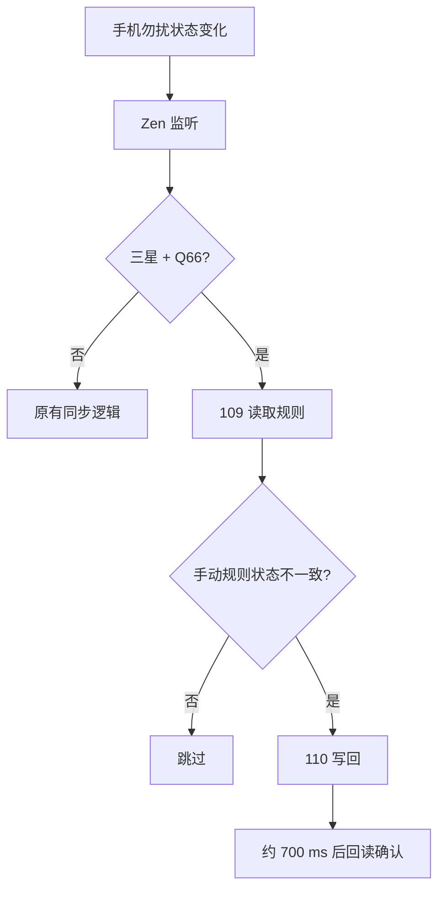

# 调查与实现

## 环境

| 项目 | 值 |
| --- | --- |
| 手机 | Samsung，Android 17（API 37） |
| 应用 | `com.mi.health` 3.61.0（中国版） |
| 手环 | 小米手环 11，内部型号 `miwear.watch.q66u` |

## 结论

运动健康 3.61.0 已有「勿扰模式同步」功能，但在三星 + 手环 11 组合上不生效。可行方案是在应用自身的勿扰回调里补上该型号的适配，复用现有设备连接和协议栈。

排除的方案：

- **独立 App 直连手环**：实际链路是经典蓝牙 RFCOMM/SPP（UUID `00001101-0000-1000-8000-00805F9B34FB`）。运动健康停止时探针能连上（约 0.5 秒）；运动健康在线时，探针连接会把它挤断，约 2 秒后它又重连。两者无法共存。
- **BLE/GATT**：测试中未扫描到手环广播，GATT 未建立（不代表设备一定不支持 BLE）。
- **系统或应用公开接口**：未发现第三方可调用的勿扰写入 API。Binder 路径有签名校验，Provider 只读。

## 协议

补丁通过应用内部的 `DeviceContact.call` 发送请求，不涉及蓝牙握手和加密。

| 请求 | 作用 |
| --- | --- |
| `type=2, id=109` | 读取勿扰规则列表 |
| `type=2, id=110` | 写回勿扰规则 |

规则列表中用 `c` 字段定位唯一的手动规则，`e` 为状态，`g` 为时间戳（由代码和实测行为推断）。

手机状态取自 `NotificationManager.getCurrentInterruptionFilter()`：

- `INTERRUPTION_FILTER_ALL` → 手环手动状态 `0`（关闭）
- 优先级 / 仅闹钟 / 完全静音 → `1`（开启）
- 未知值 → 不写入

## 流程

写入前检查设备 ID、应用内「同步手机」开关和请求序号（丢弃过期回调）。回读只记录结果，不重试。

## 改动文件

均位于 `smali_classes11/com/xiaomi/fitness/devicesettings/`：

| 文件 | 改动 |
| --- | --- |
| `DeviceSettingsSyncer.smali` | 设备同步时若有勿扰权限且功能判定通过，注册 Zen 监听 |
| `utils/ZenUtils.smali` | 防止重复注册监听；去掉旧逻辑对 API 35+ 的一刀切拒绝，三星 Q66 直接放行，其他机型回落到原有 `quiet_mode` 判定（未做实机回归） |
| `utils/ZenUtils$postSyncZenMode$2.smali` | Q66 走新增规则逻辑，其他设备不变 |
| `utils/Q66ZenRules.smali` | 新增：读取、比较、写回、回读 |

## 调查方法

1. ADB 确认包名、版本、设备型号。
2. Apktool 解包，JADX 搜索 Zen、DND、`DeviceContact`、`ZenModeSettingFragment` 等。
3. 开启开发者选项中的「蓝牙 HCI 信息收集」，用 `adb bugreport` 导出 btsnoop，在 Wireshark 中查看 `btrfcomm` / `btsdp` / `btatt`。
4. 用[探针](../probe/README.md)分别在运动健康停止和在线时测试 SPP 连接。
5. 打补丁、重签、安装，手动切换手机勿扰观察手环。

## 参考

- [Gadgetbridge](https://codeberg.org/Freeyourgadget/Gadgetbridge)：小米设备支持实现
- [miwear-ble-protocol](https://github.com/Zioove/miwear-ble-protocol)：BLE 上的 SAR 分帧、多通道和 protobuf
